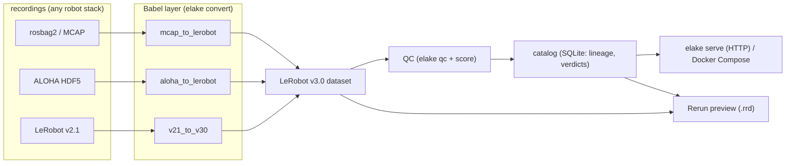

# embodied-lake (working title)

[](https://github.com/kittimzhe/embodied-lake/actions/workflows/ci.yml)
[](https://github.com/kittimzhe/embodied-lake/releases/tag/v0.1.3)
[](LICENSE)

> LeRobot-native, self-hostable data platform for embodied AI — an open alternative to the (closed-source) Foxglove Data Platform, built on the [LeRobot dataset format](https://huggingface.co/docs/lerobot/lerobot-dataset-v3) (the de-facto standard: 5,750+ datasets on the Hugging Face Hub) and [Rerun](https://github.com/rerun-io/rerun) as the multimodal data layer.

**Status: Phase 2 complete — Babel layer + QC + self-hosted management (catalog, snapshots, web UI). Phase 3 (dataset intelligence) underway.** See [docs/roadmap.md](docs/roadmap.md).

## Why

Embodied AI is bottlenecked on data infrastructure. The chain
`collect → annotate → QC → manage → simulate → train` has open gaps
(no format Babel layer, no robot-native annotation tooling, no self-hosted
platform since Foxglove went closed-source in 2024). embodied-lake targets:

1. **Babel layer** — convert MCAP / rosbag2 / HDF5 (ALOHA) / RLDS /
   LeRobot v2.1 ⇄ v3.0, with incremental migration.
2. **QC pipeline** — structural validation now; batch scoring via VLM reward
   models (e.g. NVIDIA Flora) later; quality reports throughout.
3. **Dataset management** — catalog, versioning, multi-tenancy, on-prem
   deployment (Docker Compose), Rerun-powered episode preview.

## Install & quick start

```bash
pip install -e ".[babel]"  # base CLI + converters (pyarrow/pandas/mcap/h5py — no torch)
```

```bash
# --- inspect: dataset card for any local or Hub dataset ---------------------
elake inspect Embodied-AI-6/dataset      # Hub dataset (5,750+ available)
elake inspect ./my_dataset --json        # local dataset, machine-readable

# --- convert: get existing data INTO LeRobot v3.0 ---------------------------
elake convert v21-to-v30 ./ds_v21 ./ds_v30            # LeRobot v2.1 -> v3.0
elake convert v21-to-v30 ./ds_v21 ./ds_v30 --drop-videos   # tabular-only mode
elake convert mcap-to-v30 rec_*.mcap ./ds \
    --state-topic /arm/joint_states --action-topic /arm/command   # rosbag2/MCAP
elake convert hdf5-to-v30 episode_*.hdf5 ./ds         # ALOHA-style HDF5

# --- catalog & ingest: the platform loop -------------------------------------
elake ingest rec_*.mcap ./ds --mode mcap-to-v30 --state-topic /arm/joint_states
#            ^ convert -> structural qc gate -> score -> register (one command)
elake catalog list                            # registry with qc verdicts + lineage
elake serve --port 8317                        # HTTP API + web catalog UI over the registry
# docker/docker-compose.yml                    # one-command on-prem deployment
```

### Self-hosted platform surface

`elake serve` (stdlib only, no server framework) exposes:

| route | what |
|---|---|
| `/` | web catalog: dataset table (format, episodes, frames, fps, QC verdict, score) with one-click episode preview |
| `/api/datasets` | JSON list / detail incl. lineage and QC results |
| `/api/datasets` (POST) | register a dataset from CI or scripts |
| `/preview/*.rrd` | rendered Rerun episodes — opened in the hosted Rerun web viewer |

`elake preview <ds> [--compare <reference>]` renders headlessly to `.rrd`; with
`--compare` it emits `a`/`b`/`delta` channels per feature on a shared timeline
(flat delta = output matches reference) — the pattern shared as a workaround
recipe on [rerun#12984](https://github.com/rerun-io/rerun/issues/12984).

`ingest` wires the whole pipeline: convert → QC gate → score → register.

# --- qc + scoring ------------------------------------------------------------
elake qc ./ds_v30                          # structural PASS/FAIL, exit code 1 on error
elake diff ./ds_v21 ./ds_v30 --expect-migration   # conversion validation: value-level
                                           # (the check used against official pusht v3.0)
elake snapshot create ./ds_v30 -m "post-QC baseline"   # content-addressed pin
elake snapshot verify ./ds_v30                    # drift detection (exit 1 on change)
elake score ./ds_v30 --min-score 80        # content rules: frozen joints, saturation, non-unit quaternions,
                                           # action spikes, low-motion episodes
```

## Validated against real data

**Dataset #2 — `lerobot/aloha_sim_transfer_cube_human`** (50 eps / 20,000 frames,
14-DoF bimanual): same treatment — tasks, episodes metadata (49 cols), per-episode
tabular stats (45 cols), aggregate stats, and **all 20,000 data rows × 8 columns
value-identical** against the official v3.0. Two real-world findings surfaced by
this run, now handled: official datasets disagree on the tasks column name
(`task` vs `__index_level_0__` — `elake diff` reads both), and shard boundaries
differ when videos are dropped (tabular-only output legitimately packs into
fewer size-bounded files; the row set is identical).

**Dataset #3 — real mobile-ALOHA HDF5** (`sumo43/mobile-aloha`, 3 eps / 4,500 frames,
14-DoF + mobile base, JPEG-compressed camera streams): the HDF5 converter round-trips
`qpos`/`qvel`/`action` **bit-exactly** (max|Δ| = 0.0 on all three streams), and the
content scorer earned its keep on real hardware data: it flagged exactly the two
**gripper** velocity channels (dims 6 and 13 of 14) as frozen/saturated across every
episode — anatomically correct indices, systematic across the corpus, the kind of
sensor/calibration quirk you want surfaced before training. (Camera images are
skipped with a note in this revision; `--include-qvel` emits velocities.)

**Dataset #4 — cross-project QC**: [AgiBotWorld-Beta](https://github.com/OpenDriveLab/AgiBot-World/issues/164)
(task 676, 751 frames, tabular stream-extracted without downloading videos):
the `quaternion_nonunit` rule reproduces the community-reported non-unit
quaternion norms **digit-for-digit** (ee_base 663/751 @ 1.0070, ee_camera
737/751 @ 1.2481), extends them to the `action.*` counterparts, and
independently confirms the frozen placeholder channels — while staying silent
on joint-angle groups (norm-stability discriminator) and on the three corpora
above.

The v2.1→v3.0 converter's output was compared, artifact by artifact, with the
**official** v3.0 conversion of [`lerobot/pusht`](https://huggingface.co/datasets/lerobot/pusht)
(206 episodes / 25,650 frames) on the Hub:

- tasks / episodes metadata / info.json fields — **identical**
- 50 per-episode stats columns (vector features, element-wise) — **identical**
- aggregate `stats.json` (count-weighted moments) — **identical**
- all 25,650 data rows × 10 shared columns — **value-identical**
- only divergence: video stats columns (dropped by explicit `--drop-videos`)

The MCAP and ALOHA converters round-trip real `sensor_msgs/JointState` (CDR)
and HDF5 payloads with 1e-6 precision in the test suite (25 tests).

## Throughput (real data, Apple silicon, best of 3)

| converter | rate | DROID-scale extrapolation (tabular) |
|---|---|---|
| v2.1 → v3.0 (pusht, 25,650 rows) | **216,000 rows/s** | ~2 min |
| v2.1 → v3.0 (synthetic scale: 20k episodes / 4M rows / 174 MB) | **395,000 rows/s** — QC PASS, source-vs-output diff IDENTICAL, shards into 2 data files | ~30 s |
| MCAP → v3.0 (10,000 frames, incl. CDR decode) | **61,000 rows/s** | ~6 min |

Reference: the LanceDB DROID full conversion (76k trajectories, incl. video +
vector pipelines) runs 34 min — embodied-lake's tabular path is not the
bottleneck; video handling is the open work (see roadmap).

## Architecture



## Design notes

- **Dependency-light by design**: conversion and QC need only
  pyarrow/pandas/numpy (+ `mcap`/`h5py` per source format). No `lerobot`
  install, no torch — safe to run on collection machines and CI.
- **Upstream-compatible artifacts**, not "close enough": tasks.parquet is
  written with the pandas index layout upstream readers expect; per-episode
  stats carry the full key set (min/max/mean/std/count/q01–q99); constant
  `meta/episodes` columns match what real v3.0 datasets on the Hub contain.
- **QC as a first-class product**: every conversion ends with a `elake qc`
  gate (index continuity, file coverage, frame counts, split bounds, stats
  presence) before data enters the catalog.

## Repo layout

```
src/embodied_lake/
  inspect.py       # dataset card inspector (stdlib-only, v2/v3)
  babel/           # format conversion layer (v21_to_v30, mcap, aloha/hdf5)
  qc/              # structural QC pipeline
  platform/        # Phase 2: catalog / multi-tenancy / API (planned)
tests/             # pytest suite (23 tests: offline fixtures + optional network)
docs/roadmap.md    # phased plan & evidence ledger
```

## Roadmap

- [x] Phase 0 — repo skeleton, `elake inspect` (local + Hub)
- [~] Phase 1 — Babel layer (v2.1→v3.0 ✅, MCAP ✅, ALOHA HDF5 ✅; RLDS next) + QC (structural ✅, scoring next)
- [ ] Phase 2 — platform & open-source release (catalog, Rerun preview, Docker Compose)
- [ ] Phase 3 — deep dive: fleet collection orchestration **or** VLM auto-annotation

## License

Apache-2.0 (matching the LeRobot / Rerun ecosystem).

## Acknowledgements

Built on top of — and contributing back to — [huggingface/lerobot](https://github.com/huggingface/lerobot) and [rerun-io/rerun](https://github.com/rerun-io/rerun).
